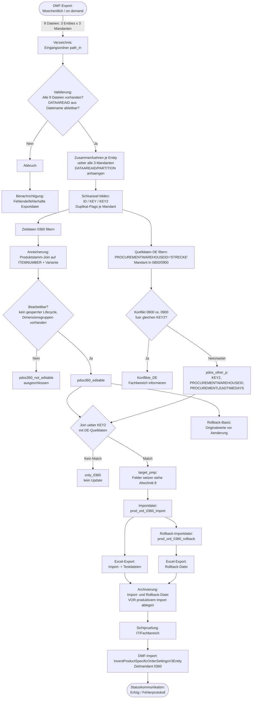

# Schnittstellenspezifikation & Technical Design Document (TDD)
## MD3-1004 Wiederbeschaffungszeit – Übernahme VfZ Direktlieferungsartikel (DE → 0360)

> **Metadaten zur Dokumentation**
> * **Ticket-Referenz / ID:** MD3-1004
> * **Autor / Verantwortlicher:** Cedric Kameni
> * **Fachbereich / Anforderer:** Vertrieb/Logistik 0360 (Ansprechpartner: Frank Hoffmann)
> * **Status:** Entwurf
> * **Datum / Version:** 2026-10-29 | Version 1.0
> * **Referenzimplementierung (Prototyp):** `MD3-1004_Wiederbeschaffungszeit_Playbook_DMF.Rmd` (R, manueller Lauf). Dieses Dokument beschreibt die fachliche und technische Logik unabhängig von R, damit sie 1:1 als automatisierter Power-Automate-Flow nachgebaut werden kann.

---

## 1. Übersicht

### 1.1 Problem

Im österreichischen Mandanten **0360** ist keine Lieferdatumskontrolle aktiv. Dadurch wird das Versanddatum bei der Auftragserfassung unabhängig vom Artikeltyp automatisch auf das aktuelle Tagesdatum gesetzt.

Für Artikel, die in den deutschen Mandanten **0800/0900** als Direktlieferungsartikel geführt werden (`PROCUREMENTWAREHOUSEID = 'STRECKE'`), ist dort eine Wiederbeschaffungszeit (VfZ) hinterlegt. Diese wird aktuell **nicht** in die verkaufsseitigen Standardauftragseinstellungen von 0360 übernommen und somit bei der Terminermittlung nicht berücksichtigt. Für diese Artikel wird in 0360 daher fälschlicherweise ein Versanddatum "heute" vorgeschlagen, obwohl aufgrund der Wiederbeschaffungszeit ein zukünftiger Termin korrekt wäre.

### 1.2 Fachlicher Hintergrund / gewünschtes Verhalten

Die Wiederbeschaffungszeit von Direktlieferungsartikeln soll in die verkaufsseitigen Standardauftragseinstellungen (`InventProductSpecificOrderSettingsV3Entity`) von 0360 als Vertriebslieferzeit übernommen werden, damit bei der Auftragserfassung ein realistisches Versanddatum ermittelt wird. Laut Anforderung des Fachbereichs (Frank Hoffmann, 02.09.2026) werden für alle betroffenen Artikel in 0360 folgende Felder in den Standardauftragseinstellungen / Fast-Tab "Auftrag" aktualisiert:

| Feld (Anzeige D365FO) | Feld (Entity) | Wert |
|---|---|---|
| Lieferungskontrolle überschreiben | `ARESALESDEFAULTORDERSETTINGSOVERRIDDEN` | `"Yes"` |
| Lieferdatumskontrolle | `SALESORDERPROMISINGMETHOD` | `"ATPPlusIssueMargin"` (= VfZ + Sicherheitszuschlag für Warenabgang) |
| VfZ Planungszeitraum | `SALESATPTIMEFENCEDAYS` | = `PROCUREMENTLEADTIMEDAYS` ("Lieferzeit Einkauf", Fast-Tab "Bestellung") aus dem jeweiligen deutschen Mandanten |

Dies gilt für **alle Artikel in 0360, die in den deutschen Mandanten (0800 oder 0900) als Direktlieferungsartikel geführt werden**.

Die Aktualisierung soll gemäß Anforderung **automatisiert und wöchentlich** laufen (Batch-/Nachlauf), damit Änderungen der Wiederbeschaffungszeit in DE regelmäßig nach 0360 nachgezogen werden. Der aktuelle Stand (`Playbook_DMF.Rmd`) ist ein manuell angestoßener R-Prototyp; Ziel dieses Dokuments ist die 1:1-Übertragung der darin verifizierten Logik in einen automatisierten Power-Automate-Flow.

> [!NOTE]
> **Sichtprüfung & operative Sorgfalt:**
> Nach der Transformation führt die IT (bzw. im aktuellen Prototyp: Cedric Kameni) vor jedem produktiven Import eine Sichtprüfung der generierten Importdatei durch (Stichproben über die Testdateien aus Abschnitt 10, Prüfung der `Konflikte_DE`- und `only_0360`-Blätter). Erst danach wird die Datei in D365FO importiert. Zusätzlich wird bei jedem Lauf eine Rollback-Importdatei mitgeneriert (siehe Abschnitt 11) und **vor dem produktiven Import archiviert**, damit die Änderung bei Bedarf rückgängig gemacht werden kann.

---

## 2. Abgrenzungen (Verantwortlichkeiten)

### 2.1 Technische Prüfung (Verantwortung IT)
* **Format- und Strukturtreue:** 9 erwartete DMF-Export-Dateien (3 Entitäten × 3 Mandanten, siehe Abschnitt 4) liegen vollständig und im richtigen Format (`.xlsx`) vor.
* **Datentypprüfung:** `PROCUREMENTLEADTIMEDAYS`, `SALESATPTIMEFENCEDAYS`, `SALESLEADTIMEDAYS` und `ORDERSETTINGSRANK` sind numerisch konvertierbar.
* **Schlüsselkonsistenz:** Keine unerwarteten Duplikate je Mandant (`is_duplicate`, siehe Abschnitt 4.2), DATAAREAID korrekt aus dem Dateinamen ableitbar.

### 2.2 Fachliche Verantwortung (Verantwortung Fachbereich)
* **Konfliktentscheidung 0800 vs. 0900:** Liefert ein Artikel in beiden deutschen Mandanten unterschiedliche Wiederbeschaffungszeiten für denselben Schlüssel (`KEY2`), ist dies ein **fachlicher** Konflikt (siehe `Konflikte_DE`-Blatt), keine technische Abweichung. Die IT führt hier keine automatische Priorisierung durch.
* **Ausschluss nicht bearbeitbarer Artikel:** Artikel mit gesperrtem Lifecycle-Status oder fehlender Dimensionsgruppe (`pdos360_not_editable`) werden technisch korrekt ausgeschlossen; ob das im Einzelfall fachlich unkritisch ist, verbleibt beim Fachbereich.
* **Artikel ohne DE-Match (`only_0360`):** Ob ein Artikel, der in 0360 existiert aber in keinem deutschen Mandanten als Direktlieferungsartikel gefunden wird, zu Recht unverändert bleibt, ist eine fachliche Einschätzung.

> [!WARNING]
> Entspricht eine der 9 Quelldateien nicht der erwarteten Struktur (fehlende Datei, falsches Namensschema, fehlende Pflichtspalten), wird der Lauf abgebrochen und nicht automatisch fortgesetzt.

---

## 3. Technische Anbindung & Prozessablauf

### 3.1 Prozessschaubild



### 3.2 Erläuterung zum Prozess

1. **Export (Quelle):** Pro Lauf werden aus D365FO per Data-Management-Framework (DMF) **9 Dateien** exportiert — 3 Data Entities je 3 Mandanten (0360, 0800, 0900). Siehe Abschnitt 4.
2. **Bereitstellung:** Die Dateien werden in einem definierten Eingangsverzeichnis abgelegt (im Prototyp: lokaler Pfad `path_in`; produktiv: Netzlaufwerk/SharePoint-Ordner, von Power Automate zu definieren).
3. **Validierung:** Prüfung, dass alle 9 Dateien vorhanden sind und der Mandant aus dem Dateinamen-Suffix eindeutig ableitbar ist (siehe 4.2).
4. **Konsolidierung je Entity:** Je Data Entity werden die 3 Mandanten-Dateien zu einer Tabelle zusammengeführt; `DATAAREAID` wird aus dem Dateinamen ergänzt, `PARTITION` erhält einen festen Platzhalterwert (im Export nicht enthalten).
5. **Schlüsselbildung:** Für Produktstamm- und PDOS-Daten werden die Schlüssel `ID`, `KEY` und `KEY2` berechnet (siehe 4.4) sowie Duplikat-Flags je Mandant gesetzt.
6. **Trennung Ziel/Quelle:** 0360-Datensätze = Zieldaten; 0800/0900-Datensätze mit `PROCUREMENTWAREHOUSEID = 'STRECKE'` = Quelldaten (Direktlieferungsartikel DE).
7. **Anreicherung & Bearbeitbarkeitsprüfung (Ziel):** 0360-PDOS-Daten werden mit Produktstammdaten angereichert (Dimensionsgruppen, Lifecycle-Status); Artikel mit gesperrtem Status oder fehlenden Dimensionsgruppen werden ausgeschlossen (`pdos360_not_editable`).
8. **Konfliktprüfung (Quelle):** Liefern 0800 und 0900 für denselben `KEY2` unterschiedliche Wiederbeschaffungszeiten, wird dies protokolliert (`Konflikte_DE`), aber **nicht automatisch** aufgelöst.
9. **Matching:** 0360-Zieldatensätze (`pdos360_editable`) werden über `KEY2` mit den DE-Quelldaten verknüpft. Kein Match → `only_0360` (kein Update). Match → Basis für die Importdatei.
10. **Feldbefüllung & Rollback-Basis:** Die drei Zielfelder werden gesetzt (Abschnitt 8); parallel werden die **Originalwerte vor der Änderung** aus den 0360-Rohdaten gesichert (Abschnitt 11).
11. **Export:** Import- und Testdateien sowie die Rollback-Datei werden als Excel-Arbeitsmappen geschrieben und **vor dem produktiven Import archiviert**.
12. **Sichtprüfung:** IT/Fachbereich prüfen die generierten Dateien stichprobenartig.
13. **DMF-Import:** Die Importdatei wird in `InventProductSpecificOrderSettingsV3Entity` für Mandant 0360 eingespielt.
14. **Statuskommunikation:** Erfolg bzw. Fehlerprotokoll werden kommuniziert.

---

## 4. Quelle (Eingangsdaten)

### 4.1 Verzeichnis- & Dateidefinition

| Parameter | Wert / Konfiguration |
|---|---|
| **Anzahl Dateien je Lauf** | **9** (3 Data Entities × 3 Mandanten) |
| **Data Entities** | `Released products V2`, `Released product variants V2`, `Product default order settings V3` |
| **Mandanten** | `0360` (Ziel, AT), `0800`, `0900` (Quelle, DE) |
| **Dateinamensschema** | `<DMF-Exportname inkl. Entity-Label>_<DATAAREAID>.xlsx` (Beispiel: `... - Product default order settings V3_0360.xlsx`) |
| **DATAAREAID-Ableitung** | Letzter `_`-getrennter Block aus 3–4 Ziffern unmittelbar vor `.xlsx` (Regex-Logik: `.*_(\d{3,4})\.xlsx$`) |
| **PARTITION** | Im DMF-Export nicht enthalten → fester Platzhalterwert für den gesamten Lauf (Prototyp: `"1111111"`) |
| **Quellverzeichnis (Prototyp)** | `C:/Users/CKAM/Documents/RProjects/Data/MD3-1004 Wiederbeschaffungszeit/PRJ/` (lokaler Entwicklungspfad — **vor Produktivsetzung durch produktiven Austauschordner ersetzen**) |
| **Ausgabeverzeichnis (Prototyp)** | `C:/Users/CKAM/Documents/RProjects/Data/MD3-1004 Wiederbeschaffungszeit/` (ebenfalls zu ersetzen) |
| **Trigger** | Aktuell manuell (R-Lauf). **Soll-Zustand laut Ticket: wöchentlich automatisiert.** |

> [!IMPORTANT]
> Der aktuelle Prototyp prüft **nicht automatisiert**, wie alt die DMF-Exporte sind. Für den automatisierten wöchentlichen Lauf in Power Automate sollte eine Freshness-Regel ergänzt werden (z. B.: alle 9 Dateien eines Laufs müssen aus demselben Exportfenster/Tag stammen). Dies ist mit dem Fachbereich/der IT vor Produktivsetzung zu bestätigen.

### 4.2 Bedingungen & Validierungsregeln

* Alle Spalten werden als **Text** eingelesen (kein automatisches Typing durch Excel), numerische Felder werden erst im Transformationsschritt explizit konvertiert (`PROCUREMENTLEADTIMEDAYS`, `SALESLEADTIMEDAYS`, `SALESATPTIMEFENCEDAYS`, `ORDERSETTINGSRANK`).
* **Normalisierung** (wie im SQL-basierten Schwesterprozess `MD3-1004_Wiederbeschaffungszeit_Playbook.Rmd`): Schlüsselfelder (`ITEMNUMBER`, `PRODUCTCONFIGURATIONID`, `PRODUCTSIZEID`, `PRODUCTCOLORID`, `PRODUCTSTYLEID`, `PRODUCTVERSIONID`) werden kleingeschrieben, leere/`NULL`-Werte zu `""` normalisiert.
* **Duplikatprüfung je Mandant:**
  * `is_duplicate` = mehrfacher `KEY` (Artikel/Variante + Standort + Mandant + Partition) → Hinweis auf fehlerhaften Export.
  * `is_duplicate2` = mehrfacher `KEY2` (zusätzlich `ORDERSETTINGSRANK`) → wird u. a. für den Rollback-Mechanismus benötigt (Abschnitt 11).

### 4.3 Benötigte Spalten je Entity

**Released products V2** (Mandanten-weit, Master-Ebene): `ITEMNUMBER`, `PRODUCTNUMBER`, `PRODUCTLIFECYCLESTATEID`, `PRODUCTDIMENSIONGROUPNAME`, `STORAGEDIMENSIONGROUPNAME`, `TRACKINGDIMENSIONGROUPNAME`.

**Released product variants V2** (Varianten-Ebene): `ITEMNUMBER`, `PRODUCTMASTERNUMBER`, `PRODUCTLIFECYCLESTATEID`, `PRODUCTCONFIGURATIONID`, `PRODUCTSIZEID`, `PRODUCTCOLORID`, `PRODUCTSTYLEID`, `PRODUCTVERSIONID`, `WIBURETAILVARIANTID`. Fehlende Dimensionsgruppen/Lifecycle-Werte werden vom zugehörigen Master-Datensatz übernommen (Fallback).

**Product default order settings V3**: `ITEMNUMBER`, `OPERATIONALSITEID`, `PRODUCTCONFIGURATIONID`, `PRODUCTSIZEID`, `PRODUCTCOLORID`, `PRODUCTSTYLEID`, `PRODUCTVERSIONID`, `ORDERSETTINGSRANK`, `ISSALESLEADTIMEOVERRIDDEN`, `PROCUREMENTLEADTIMEDAYS`, `SALESLEADTIMEDAYS`, `ARESALESDEFAULTORDERSETTINGSOVERRIDDEN`, `SALESORDERPROMISINGMETHOD`, `SALESATPTIMEFENCEDAYS`, `PROCUREMENTWAREHOUSEID`.

### 4.4 Schlüsseldefinitionen

| Schlüssel | Aufbau | Zweck |
|---|---|---|
| `ID` | `<ITEMNUMBER>-<CONFIG>-<COLOR>-<SIZE>-<STYLE>-<VERSION>-<DATAAREAID>-<PARTITION>` | Verknüpfung PDOS ↔ Produktstamm (Anreicherung) |
| `KEY` | `<ITEMNUMBER><OPERATIONALSITEID><CONFIG><COLOR><SIZE><STYLE><VERSION><DATAAREAID><PARTITION>` | Eindeutigkeit je Mandant (Duplikaterkennung) |
| `KEY2` | `<ITEMNUMBER><OPERATIONALSITEID><CONFIG><COLOR><SIZE><STYLE><VERSION><ORDERSETTINGSRANK>` | **Mandantenübergreifender** Schlüssel — verknüpft DE-Quelle mit 0360-Ziel (ohne `DATAAREAID`/`PARTITION`) |

---

## 5. Ziel (Zielsystem & Entität)

### 5.1 D365FO-Zielkonfiguration

| Parameter | Wert / Spezifikation |
|---|---|
| **Geschäftsobjekt / Entität** | `InventProductSpecificOrderSettingsV3Entity` (Standardauftragseinstellungen) |
| **Zielmandant** | `0360` |
| **Anwendung / Modul** | Datenverwaltung (DMF) |
| **Importprojekt / -profil** | {{noch zu benennen — im Prototyp nicht hinterlegt; vor Power-Automate-Umsetzung mit IT abstimmen}} |

> [!IMPORTANT]
> **Kein `DATAAREAID`-Feld in der Importdatei:** Die finale Importdatei (`prod_ord_0360_import`) enthält **bewusst keine** `DATAAREAID`-Spalte — weder die des Ziels (0360) noch die der DE-Quelle. Grund: Beim Verknüpfen der 0360-Zieldaten mit den DE-Quelldaten über `KEY2` tragen beide Tabellen eine eigene `DATAAREAID`-Spalte; da diese nicht Teil des Join-Schlüssels ist, werden sie automatisch als Konfliktspalten markiert und in beiden Playbook-Varianten (DB- und DMF-basiert) konsequent aus der finalen Importdatei entfernt. Das setzt voraus, dass **das DMF-Importprojekt direkt auf Mandant 0360 skaliert ist** (Single-Company-Import). **Dies vor der Power-Automate-Umsetzung mit der IT bestätigen**, da ein Multi-Company-Importprojekt ohne `DATAAREAID`-Spalte fehlschlagen würde.

> [!IMPORTANT]
> **Aktualitätsanforderung (Freshness-Regel):** Im aktuellen Prototyp nicht technisch erzwungen (siehe 4.1). Für den produktiven, automatisierten Lauf empfehlen wir, vor dem Import sicherzustellen, dass alle 9 Quelldateien aus demselben, aktuellen Exportlauf stammen.

---

## 6. Datenanreicherung (Vorbereitende Lookups)

Da die Quelle DMF-Exporte (keine Live-Datenbankverbindung) sind, erfolgt die Anreicherung als **Join zwischen den eingelesenen Tabellen**, nicht als SQL-Lookup gegen D365FO direkt. Logisch entspricht das folgenden zwei Lookups:

**(a) Produktstamm-Anreicherung (0360):** Ergänzt PDOS-Zieldaten um Dimensionsgruppen und Lifecycle-Status.

```text
-- Logischer Lookup, ausgeführt als Join der eingelesenen DMF-Exporte (nicht live gegen D365FO)
SELECT prod.TRACKINGDIMENSIONGROUPNAME, prod.STORAGEDIMENSIONGROUPNAME,
       prod.PRODUCTDIMENSIONGROUPNAME, prod.PRODUCTLIFECYCLESTATEID, prod.LEVEL
FROM   "Released products/variants V2 (0360)" prod
WHERE  prod.ITEMNUMBER = pdos360.ITEMNUMBER
  AND  prod.PRODUCTCONFIGURATIONID = pdos360.PRODUCTCONFIGURATIONID
  AND  prod.PRODUCTCOLORID         = pdos360.PRODUCTCOLORID
  AND  prod.PRODUCTSIZEID          = pdos360.PRODUCTSIZEID
  AND  prod.PRODUCTSTYLEID         = pdos360.PRODUCTSTYLEID
  AND  prod.PRODUCTVERSIONID       = pdos360.PRODUCTVERSIONID
```

Referenzierung im Mapping: `{prod.PRODUCTLIFECYCLESTATEID}` etc.

**(b) DE-Lookup (Wiederbeschaffungszeit):** Ermittelt für jeden 0360-Artikel die Wiederbeschaffungszeit aus dem deutschen Mandanten, in dem er als Direktlieferungsartikel geführt wird.

```text
SELECT de.PROCUREMENTLEADTIMEDAYS, de.PROCUREMENTWAREHOUSEID, de.DATAAREAID
FROM   "Product default order settings V3 (0800, 0900)" de
WHERE  de.PROCUREMENTWAREHOUSEID = 'STRECKE'
  AND  de.DATAAREAID IN ('0800', '0900')
  AND  de.KEY2 = pdos360.KEY2   -- siehe Schlüsseldefinition Abschnitt 4.4
```

Referenzierung im Mapping: `{de.PROCUREMENTLEADTIMEDAYS}`.

> [!WARNING]
> Liefert dieser Lookup für denselben `KEY2` unterschiedliche Werte aus 0800 **und** 0900, handelt es sich um einen fachlichen Konflikt (siehe Abschnitt 2.2) — beide Treffer werden im Prototyp aktuell **nicht automatisch dedupliziert**, sondern erzeugen potenziell mehrere Zeilen im Zwischenergebnis. Für Power Automate ist hier explizit eine Konfliktregel zu definieren (z. B. "ersten Treffer verwenden" + Pflicht-Eskalation), statt das Verhalten des Prototyps unverändert zu übernehmen.

---

## 7. Mapping-Regeln & Syntax

### 7.1 Syntax-Konventionen

| Syntax-Beispiel | Aufbau | Bedeutung |
|---|---|---|
| `"Fester Wert"` | In Anführungszeichen | Statischer Festwert. |
| `<Feldname>` | In spitzen Klammern | Feld direkt aus den 0360-Zieldaten (DMF-Export). |
| `{prod.Feldname}` | Geschweifte Klammern, Alias `prod` | Angereichertes Feld aus dem Produktstamm-Lookup (Abschnitt 6a). |
| `{de.Feldname}` | Geschweifte Klammern, Alias `de` | Angereichertes Feld aus dem DE-Lookup (Abschnitt 6b). |
| `if (...) { ... }` | Pseudocode | Bedingte Logik / Filterregel. |

---

## 8. Feld-Mapping-Tabelle (Importdatei `prod_ord_0360_import`)

| Nr. | Zielfeld (Entity) | Mappingregel / Quelle | Bemerkung |
|:---:|---|---|---|
| 1 | `ITEMNUMBER` | `<ITEMNUMBER>` (0360, kleingeschrieben) | Schlüsselfeld |
| 2 | `OPERATIONALSITEID` | `<OPERATIONALSITEID>` (0360) | Schlüsselfeld |
| 3 | `PRODUCTCONFIGURATIONID` | `<PRODUCTCONFIGURATIONID>` (0360, normalisiert) | Schlüsselfeld |
| 4 | `PRODUCTSIZEID` | `<PRODUCTSIZEID>` (0360, normalisiert) | Schlüsselfeld |
| 5 | `PRODUCTCOLORID` | `<PRODUCTCOLORID>` (0360, normalisiert) | Schlüsselfeld |
| 6 | `PRODUCTSTYLEID` | `<PRODUCTSTYLEID>` (0360, normalisiert) | Schlüsselfeld |
| 7 | `PRODUCTVERSIONID` | `<PRODUCTVERSIONID>` (0360, normalisiert) | Schlüsselfeld |
| 8 | `ORDERSETTINGSRANK` | `<ORDERSETTINGSRANK>` (0360) | Schlüsselfeld, Teil von `KEY2` |
| 9 | `SALESATPTIMEFENCEDAYS` | `{de.PROCUREMENTLEADTIMEDAYS}` | **Kernanforderung:** VfZ Planungszeitraum = Wiederbeschaffungszeit DE |
| 10 | `ARESALESDEFAULTORDERSETTINGSOVERRIDDEN` | `"Yes"` | Fester Wert — Lieferungskontrolle überschreiben |
| 11 | `SALESORDERPROMISINGMETHOD` | `"ATPPlusIssueMargin"` | Fester Wert — Lieferdatumskontrolle = VfZ + Sicherheitszuschlag |

**Nicht in die Importdatei übernommene Hilfsfelder** (nur für Filterung/Lookup verwendet, nicht geschrieben): `PRODUCTLIFECYCLESTATEID`, `TRACKINGDIMENSIONGROUPNAME`, `STORAGEDIMENSIONGROUPNAME`, `PRODUCTDIMENSIONGROUPNAME`, `PROCUREMENTWAREHOUSEID`, `DATAAREAID` (siehe Hinweis Abschnitt 5.1).

### 8.1 Filter-/Ausschlussregeln vor dem Mapping

```text
if ( isLeer(<TRACKINGDIMENSIONGROUPNAME>)
     OR isLeer(<STORAGEDIMENSIONGROUPNAME>)
     OR <PRODUCTLIFECYCLESTATEID> IN ("Gesperrt", "Final gesperrt") )
{
  → Datensatz nach "pdos360_not_editable", KEIN Update
}

if ( kein Treffer im DE-Lookup (Abschnitt 6b) für KEY2 )
{
  → Datensatz nach "only_0360", KEIN Update
}
```

---

## 9. Fehlerbehandlung & Eskalation

| Fehlerfall | Erkennungszeitpunkt | Systemreaktion | Maßnahme / Eskalation |
|---|---|---|---|
| Eine oder mehrere der 9 Exportdateien fehlen | Vor Verarbeitung | Abbruch | Benachrichtigung IT: fehlende Datei(en) benennen |
| `DATAAREAID` nicht aus Dateinamen ableitbar | Vor Verarbeitung | Abbruch | Benachrichtigung: Dateinamensschema prüfen |
| Nicht-numerische Werte in `PROCUREMENTLEADTIMEDAYS` / `SALESATPTIMEFENCEDAYS` / `ORDERSETTINGSRANK` | Typkonvertierung | Zeile/Lauf protokollieren | IT prüft Exportqualität |
| Duplikat `KEY` innerhalb eines Mandanten (`is_duplicate`) | Schlüsselbildung | Protokollierung, kein automatischer Abbruch | IT prüft Exportqualität vor Freigabe |
| Konflikt 0800 vs. 0900 für gleichen `KEY2` | DE-Lookup | Protokollierung (`Konflikte_DE`), **kein** automatischer Abbruch im Prototyp | **Fachliche Entscheidung** erforderlich, siehe Abschnitt 2.2 — für Power Automate verbindliche Konfliktregel definieren |
| Artikel nicht bearbeitbar (gesperrt / fehlende Dimensionsgruppe) | Bearbeitbarkeitsprüfung | Ausschluss (`pdos360_not_editable`), kein Abbruch des Laufs | Information an Fachbereich, keine automatische Eskalation nötig |
| Kein DE-Match für 0360-Artikel | Matching | Ausschluss (`only_0360`), kein Abbruch des Laufs | Fachbereich informieren, ob Artikel zu Recht Direktlieferungsartikel in DE, aber (noch) nicht korrekt gepflegt |
| DMF-Import technisch fehlgeschlagen | Zielsystem-Übergabe | Log-Eintrag | IT prüft Systemverfügbarkeit/Berechtigung; Rollback-Datei bleibt nutzbar, da noch kein Import erfolgte |

---

## 10. Testdateien

Vor dem produktiven Import werden aus der finalen Importdatei bis zu **5 Testdateien à 10 Datensätze** (max. 50 Datensätze, zufällige, reproduzierbare Stichprobe — fester Seed) erzeugt. Diese dienen dazu, den Import zunächst im Kleinen (z. B. in einer Testumgebung) zu verifizieren, bevor die vollständige Importdatei produktiv eingespielt wird. Bei weniger als 10 Datensätzen in der Importdatei entfällt dieser Schritt.

---

## 11. Rollback-Mechanismus

### 11.1 Zweck

Da die Änderung produktive Stammdaten in 0360 betrifft, wird bei **jedem Lauf zusätzlich zur Importdatei eine Rollback-Importdatei** erzeugt. Sie enthält für exakt dieselben Datensätze wie die Importdatei die **ursprünglichen** (unveränderten) Werte der drei gesetzten Felder:

| Feld | Rollback-Wert |
|---|---|
| `SALESATPTIMEFENCEDAYS` | Originalwert aus dem 0360-Export vor der Änderung |
| `ARESALESDEFAULTORDERSETTINGSOVERRIDDEN` | Originalwert aus dem 0360-Export vor der Änderung |
| `SALESORDERPROMISINGMETHOD` | Originalwert aus dem 0360-Export vor der Änderung |

Die Zuordnung erfolgt über `KEY2` (Abschnitt 4.4).

> [!IMPORTANT]
> **Zeitpunkt:** Die Rollback-Datei muss aus **demselben Lauf** wie die Importdatei erzeugt und **vor dem produktiven Import archiviert** werden — sie basiert auf dem Zustand von 0360 **vor** der Änderung. Ein späterer, erneuter Lauf (z. B. nächste Woche) liefert bereits den geänderten Zustand und eignet sich **nicht** mehr als Rollback-Quelle für den vorherigen Lauf. Für die automatisierte wöchentliche Ausführung bedeutet das: **jeder Lauf** muss seine eigene Rollback-Datei archivieren, bevor er importiert, damit jede einzelne Änderung separat rücknehmbar bleibt.

> [!NOTE]
> **Enum-Feld `SALESORDERPROMISINGMETHOD`:** Im DMF-Export liegt dieser Wert bereits als importfähiger String vor (anders als bei einem direkten DB-/Entity-View-Zugriff, wo er als Integer gelesen und konvertiert werden müsste — Mapping 0=Keine/None, 1=Verkaufslieferzeit/SalesLeadTime, 2=VfZ/ATP, 3=VfZ+Sicherheitszuschlag/ATPPlusIssueMargin, 4=CTP, 5=Batch-CTP; nur Wert 3 ist aus dem produktiven Forward-Import tatsächlich bestätigt). Für den DMF-Export-Weg wird der Originalwert daher unverändert übernommen, ohne Integer-zu-String-Konvertierung. **Vor Produktivsetzung stichprobenartig verifizieren**, dass der DMF-Export tatsächlich den String und nicht doch einen internen Code liefert.

### 11.2 Umgang mit nicht zuordenbaren Datensätzen

Findet sich für einen Datensatz der Importdatei kein Originalwert (z. B. Schlüssel-Mismatch), wird er **nicht** in die Rollback-Datei übernommen, sondern separat ausgewiesen (`rollback_missing`) und muss vor einem eventuellen Rollback-Import manuell geprüft werden — kein automatisches "blindes" Zurückschreiben.

### 11.3 Ablage

Import- und Rollback-Datei werden als getrennte Excel-Arbeitsmappen im Ausgabeverzeichnis abgelegt und **gemeinsam archiviert**, bevor der produktive Import angestoßen wird.

---

## 12. Offene Punkte für die Power-Automate-Umsetzung

Diese Punkte sind im R-Prototyp (noch) nicht abschließend geklärt und sollten vor der produktiven Power-Automate-Implementierung mit IT/Fachbereich bestätigt werden:

1. **Importprojekt/-profil:** Name und genaue Konfiguration des DMF-Importprojekts (Abschnitt 5.1) sind im Prototyp nicht hinterlegt.
2. **Single-Company-Annahme:** Bestätigen, dass das Importprojekt direkt auf 0360 skaliert ist (kein `DATAAREAID`-Feld in der Importdatei, Abschnitt 5.1).
3. **Freshness-Regel:** Exakte Regel definieren, wie "aktuell genug" die 9 Quelldateien für einen automatisierten wöchentlichen Lauf sein müssen (Abschnitt 4.1 / 5.1).
4. **Konfliktregel 0800/0900:** Verbindliche Regel definieren (Abschnitt 6b), statt das unveränderte Prototyp-Verhalten (keine automatische Deduplizierung) zu übernehmen.
5. **Enum-Wert-Verifikation:** `SALESORDERPROMISINGMETHOD`-Format im tatsächlichen DMF-Export stichprobenartig prüfen (Abschnitt 11.1).
6. **Mandanten als Parameter:** Ziel- (`0360`) und Quellmandanten (`0800`, `0900`) sollten als konfigurierbare Parameter statt hartcodierter Werte ausgelegt werden, falls dieselbe Logik künftig für weitere Mandantenketten wiederverwendet werden soll.

---

## 13. Revisionshistorie

| Version | Datum | Autor | Beschreibung der Änderung |
|---|---|---|---|
| 1.0 | 2026-10-29 | Cedric Kameni | Initiale Schnittstellendokumentation auf Basis des R-Prototyps `MD3-1004_Wiederbeschaffungszeit_Playbook_DMF.Rmd` inkl. Rollback-Mechanismus |
